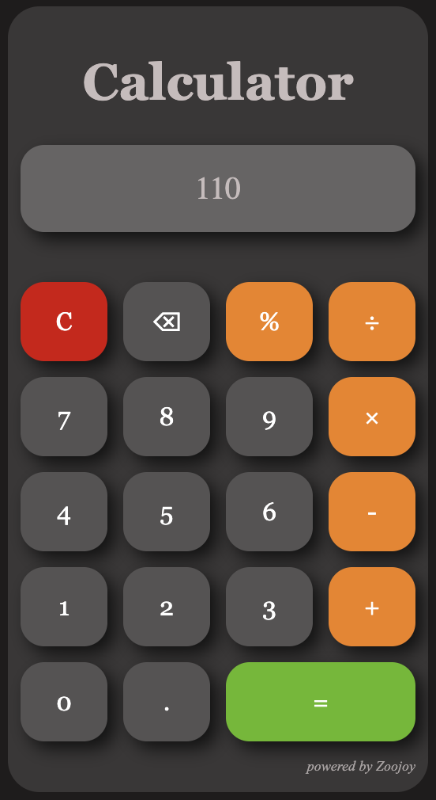

# Calculator

ACTIVE LINK : https://zoojoy.github.io/Calculator/

What is used :
1. HTML5;
2. CSS3
3. JavaScript 

What I've practised here : 

1. Functions and Logic

Creating reusable functions for arithmetic operations.
Using switch statements to handle different operators.
Implementing an operate() function to execute calculations.
Working with function parameters and return values.

2. DOM Manipulation

Selecting elements with querySelector() and querySelectorAll().
Updating the calculator display using textContent.
Reading button values from HTML elements.
Using classList.add() and classList.remove() to modify CSS classes.

3.  Event handling

Adding event listeners with addEventListener().
Handling mouse clicks on calculator buttons.
Handling keyboard input using keydown .
Accessing keyboard input through event.key.

4. State Management

Managing calculator state using variables.
Tracking the first operand, second operand, operator, and result.
Using Boolean flags to track calculation states.
Handling new calculations after pressing equals.
Keeping user input strings separate from numerical calculation values.

5. Conditional logic 

Using if, else if, and else statements.
Comparing values using strict equality (===).
Handling different calculator states.
Preventing invalid operations, such as division by zero.

6. String and Number manipulation

Converting strings to numbers with Number().
Converting numbers to strings with String().
Building multi-digit numbers from individual keyboard inputs.
Using slice() to implement backspace.
Using includes() to validate keyboard input.
Preventing multiple decimal points in a number.
Rounding results using toFixed().

Implementing percentage calculations differently depending on the selected operator.
Calculator project helped me understand how JavaScript interacts with HTML and CSS to create an interactive application. I practised managing application state, handling different user interactions, separating input from calculation logic, and debugging unexpected behaviour.

It also helped me understand how to structure event listeners and reuse logic across mouse and keyboard interactions.

